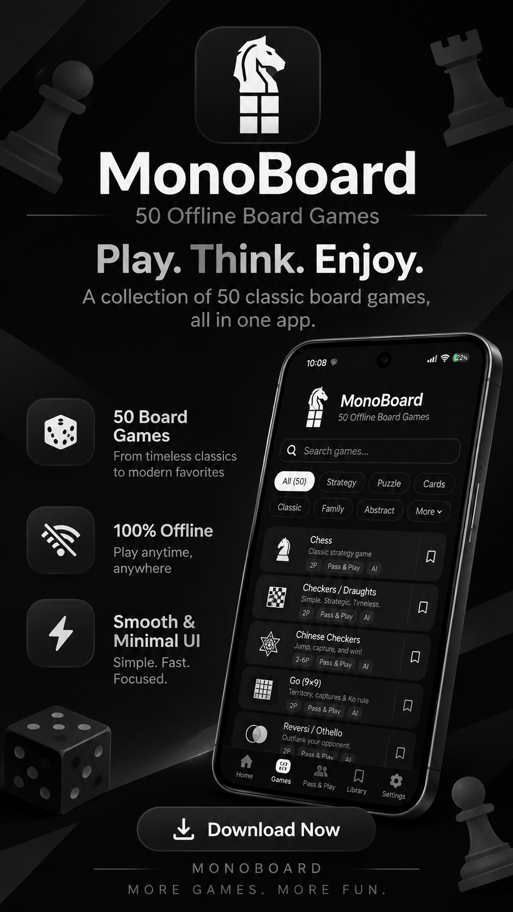
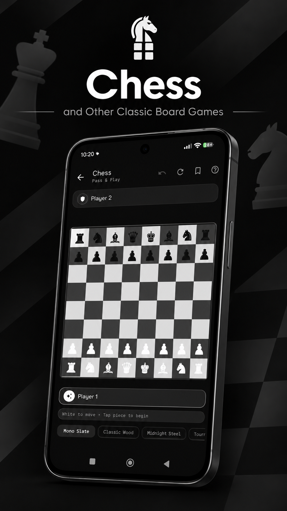
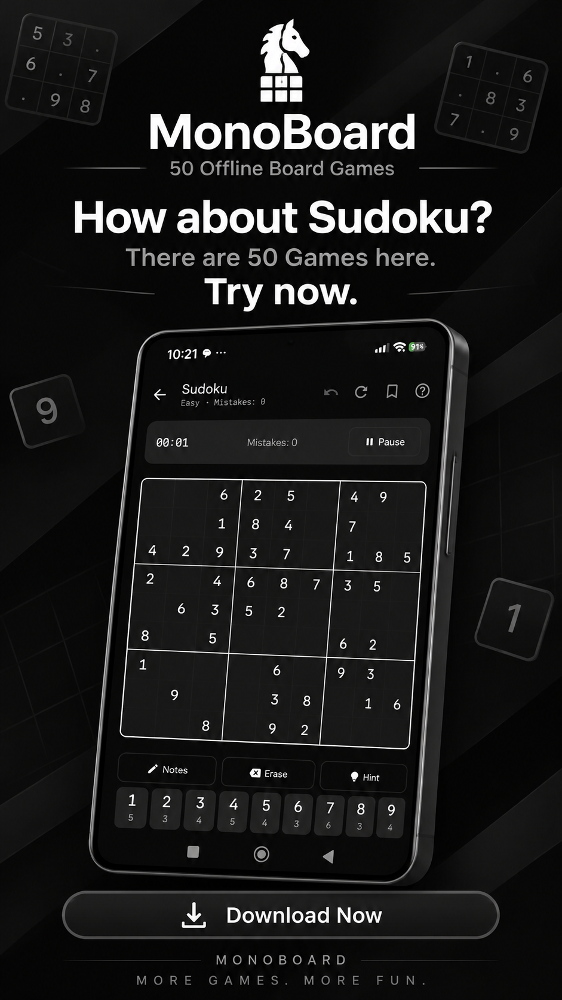

# MonoBoard

**50 Classic Offline Board, Card, Strategy, Puzzle & Word Games. One Device. Zero Internet.**

[](LICENSE)
[](https://github.com/yostevenisthegoat/MonoBoard-/releases/latest)
[](https://github.com/yostevenisthegoat/MonoBoard-/releases/latest/download/MonoBoard-v1.1.apk)
[](#)

> **Download APK:** [**MonoBoard-v1.1.apk**](https://github.com/yostevenisthegoat/MonoBoard-/releases/latest/download/MonoBoard-v1.1.apk)

---

## Screenshots

<table>
  <tr>
    <td align="center">
      
      <br /><sub><b>50 Offline Games</b></sub>
    </td>
    <td align="center">
      
      <br /><sub><b>Chess & Strategy</b></sub>
    </td>
    <td align="center">
      
      <br /><sub><b>Sudoku & Logic Puzzles</b></sub>
    </td>
  </tr>
</table>

---

## Core Philosophy

- **100% Offline & Zero Telemetry**: No `INTERNET` permission, no ads, no accounts, and no tracking.
- **Pass & Play + Privacy Curtain**: Share one phone with 2–6 players using turn-handoff screens that hide private cards, fleets, or tiles until the next player taps ready.
- **Built-in AI Opponents**: Play solo against local AI opponents that follow full game rules.
- **Mono Design Language**: Minimalist pure black (`#080808`) and charcoal (`#1B1B1B` / `#242424`) interface with optional light mode.
- **Procedural Audio & Tactile Motion (v1.1)**: Synthesized PCM sound effects, custom haptics, 3D card flips, spring-pop placements, tumbling dice, and victory confetti — with zero audio asset bloat.

---

## What's New in Monoboard 1.1

- **Synthesized Offline Audio & Haptics**: 17 procedural PCM sound cues (`WOOD_TAP`, `PIECE_SLIDE`, `DICE_ROLL`, `CARD_FLIP`, `SHUFFLE`, `TILE_MERGE`, `EXPLOSION`, `SPLASH`, `CHECK_ALERT`, `BOUNCE`, `MOVE`, `CAPTURE`, `TURN_PASS`, `HINT`, `KEY_TICK`, `ERROR`, `WIN`) paired with custom haptic waveforms.
- **Shared Motion Kit**: Spring-pop placements, bouncy presses, impact/error shakes, pulsing targets, 3D card flips, tumbling dice, animated counters, and confetti overlays.
- **Per-Game Overhaul**: Every playable game screen upgraded with responsive sound effects and Compose animations (staggered letter flips in Daily Word, pocket ripples & clacks in Carrom, 3D Reversi disc flips, Connect Four drops, Minesweeper flood/explosion shakes, and more).

See [CHANGELOG.md](CHANGELOG.md) for the full list of changes.

---

## Included Games (50)

### Strategy & Board (15)
Chess · Checkers / Draughts · Chinese Checkers · Go (9×9) · Reversi / Othello · Backgammon · Mancala · Nine Men's Morris · Shogi · Xiangqi · Ludo · Snakes & Ladders · Carrom · Dominoes · Mahjong

### Classic Casual (9)
Tic-Tac-Toe · Connect Four · Dots & Boxes · Battleship · Rock Paper Scissors · Hangman · Mastermind · Nim · Memory Match

### Puzzle Games (12)
Sudoku · Killer Sudoku · Word Search · Crossword · Nonogram · Minesweeper · 2048 · Sliding Puzzle · Kakuro · KenKen · Number Match · Jigsaw Puzzle

### Card Games (9)
Solitaire (Klondike) · Spider Solitaire · FreeCell · Hearts · Spades · Crazy Eights · Go Fish · War · Blackjack

### Word & Trivia (5)
Word Scramble · Anagrams · General Trivia · Quiz Challenge · Daily Word Challenge

---

## Building from Source

Requirements: JDK 17, Android SDK (API 36), Gradle 9.3+

```bash
gradle :app:assembleDebug
```

Debug APKs are automatically built and published to **GitHub Releases** on every push to `main` via `.github/workflows/build-apk.yml`.

---

## Contributing & License

Contributions are welcome! Check [CONTRIBUTING.md](CONTRIBUTING.md) to get started.

MonoBoard is open-source software licensed under the [MIT License](LICENSE).
